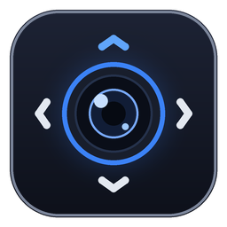

<p align="center">
  
</p>

<h1 align="center">PTZ Controller</h1>

<p align="center">
  <b>Native Windows remote for USB UVC PTZ cameras that never locks your video stream from OBS, Zoom, or Meet.</b>
  <br>
  Built in Rust with egui and fastframe — pan, tilt, smooth zoom, focus, exposure, and OBS-safe live preview in one compact window.
</p>

<p align="center">
  
  
  
  
</p>

<br>

---

```text
$ cargo run -- --probe-preview
Opening Logi Group Camera in SharedReadOnly mode...
Received live frame! Source=640x480, Preview=512x384
Testing OBS coexistence: opening a second ExclusiveControl MediaCapture while preview is open...
SharedReadOnly preview frame while OBS active: 640x480
OBS ExclusiveControl received live frame simultaneously!
Result: preview_ok=true, obs_coexistence_ok=true
```

<br>

---

## Why not vendor software or OBS Camera Properties?

Most webcam utilities either take exclusive camera control (causing a black screen in OBS), bury PTZ behind modal Win32 dialogs, or drop support for relative UVC pan/tilt cameras like the Logitech GROUP.

| Capability | PTZ Controller | OBS Properties | Vendor Suites |
| :--- | :---: | :---: | :---: |
| Runs alongside OBS / Zoom / Meet without locking | ✓ | ✗ | ⚠️ varies |
| Live preview via Windows FrameServer `SharedReadOnly` | ✓ | ✓ | ⚠️ locks OBS |
| Relative (`IKsPropertySet`) + Absolute (`IAMCameraControl`) PTZ | ✓ | ✗ (abs only) | ⚠️ brand-locked |
| Smooth hold-to-zoom + scroll wheel + keyboard shortcuts | ✓ | ✗ | ✗ |
| 400ms dead-man's switch + focus-loss motor auto-stop | ✓ | ✗ | ✗ |

## What works out of the box

- **Auto-detects real USB PTZ cameras only** — filters out virtual cameras (OBS, VTubeStudio, etc.) and non-PTZ laptop webcams automatically.
- **Universal USB UVC PTZ** — uses `PAN_RELATIVE` / `TILT_RELATIVE` when supported (e.g., Logitech GROUP / Rally / PTZ Pro) and falls back automatically to absolute `IAMCameraControl` Pan/Tilt and `ZOOM_RELATIVE` on generic UVC PTZ cameras.
- **Smooth continuous zoom** — hold `+`/`-` (with `Shift` for precision crawl), scroll over the live preview, drag the slider, or jump to `1x` / `2x` / `5x` / `10x`.
- **Stuck-motor protection** — a 400ms heartbeat watchdog stops relative PTZ motors automatically on pointer leave, `Alt+Tab` blur, `Space`/`Esc`, or app exit.
- **Aspect-locked live preview** — preserves the camera's native aspect ratio at any window size and releases the FrameServer session completely when toggled off (`P`).

## Quick Start

Download the Windows installer (`PTZ-Controller-Setup-v*-windows-x64.exe`) or portable ZIP from [GitHub Releases](https://github.com/PramaAditya/ptz-controller/releases/latest), or build from source on **Windows 10/11** with **Rust 1.98+** (pinned in [rust-toolchain.toml](rust-toolchain.toml)):

```powershell
git clone https://github.com/PramaAditya/ptz-controller.git
cd ptz-controller
cargo run --release
```

### Diagnostic CLI Flags

```powershell
cargo run -- --probe              # List DirectShow cameras and detected PTZ capabilities
cargo run -- --probe-preview      # Verify SharedReadOnly preview + simultaneous OBS coexistence
cargo run -- --nudge-right 150    # Pulse pan/tilt directly (--nudge-left, --nudge-up, --nudge-down)
```

## Controls at a Glance

Press **`?`** or **`F1`** inside the app to open the interactive keyboard cheat sheet modal.

| Input | Action |
| :--- | :--- |
| `W A S D` / `↑ ← ↓ →` | Pan & Tilt (follows **Hold** or **Nudge** mode) |
| `Space` / `Esc` | Emergency stop motor immediately |
| Hold `+` / `-` · `Scroll` | Smooth continuous zoom (`Shift` for fine/slow) |
| `1` `2` `5` `0` | Quick zoom presets (`1x` / `2x` / `5x` / `10x`) |
| `[` / `]` · `F` | Manual focus near/far · Toggle Auto Focus |
| `,` / `.` · `E` | Manual exposure darker/brighter · Toggle Auto Exposure |
| `P` · `M` · `T` · `R` | Toggle Preview · Hold/Nudge · Always-on-Top · Reconnect |

## How It Works

All Windows COM and WinRT calls are isolated off the render thread so the UI stays responsive and never locks the capture stream:

```text
egui UI Thread (eframe + fastframe)
  ├── mpsc commands ──→ DirectShow STA Thread
  │                      ├── IKsPropertySet (40-byte KSPROPERTY_CAMERACONTROL_S) ──→ Relative Pan/Tilt/Zoom
  │                      ├── IAMCameraControl (no capture graph = zero lock)    ──→ Absolute PTZ / Zoom / Focus / Exposure
  │                      └── 400ms Watchdog                                     ──→ Auto-stop on blur / drop / timeout
  └── target sync   ──→ WinRT MTA Preview Thread
                         └── MediaCapture (SharedReadOnly) + MediaFrameReader   ──→ Aspect-locked GPU texture
```

Preferences (`always_on_top`, `dark_mode`, `show_preview`, `nudge_mode`, `nudge_ms`, and last selected PTZ camera) persist automatically to `%LOCALAPPDATA%\ptz-controller\config.json`.

Built with [egui](https://github.com/emilk/egui), [fastframe](https://github.com/crmne/fastframe), and [windows-rs](https://github.com/microsoft/windows-rs).

<br>

---

<p align="center">
  <a href="PLAN.md">Architecture Plan</a> · <a href="LICENSE">MIT License</a>
</p>

<p align="center">
  <sub>Made by <a href="https://github.com/PramaAditya">Prama</a> · MIT License</sub>
</p>
